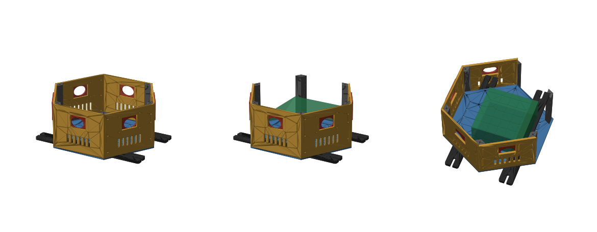

# REV10-P: printed sensor box (Bambu Lab A1, first version)

The REV9 sensor box rebuilt as flat 3D-printed parts that fit an A1 (256 mm bed). It's a hexagon of six flat panels with one camera per face, joined by corner posts. All parts print lying flat with no supports. The top is left open for now: the lidar mount isn't decided yet, and the opening also lets the compute module's heat out.



The 3D model can be viewed on GitHub at [out/assembly.stl](out/assembly.stl). The source is `box.py`, which holds every dimension.

## Parts and print files (PLA, 0.2 mm, 3 walls, 15 % infill)

| Part | Qty | Size (mm) | Print file | Time per plate | g |
|---|---|---|---|---|---|
| Wall panel (camera window, vents) | 6 | 120 × 126 × 4 | `out/print/panels_x2.gcode.3mf` (2 per plate, print 3 times) | 1 h 42 m | 72 |
| Corner post | 6 | 126 × 14 rhombus | `out/print/posts_x6.gcode.3mf` | 2 h 12 m | 76 |
| Floor (M3 grid, AGX holes) | 1 | 240 × 208 × 4 | `out/print/floor.gcode.3mf` | 2 h 13 m | 99 |
| Rail bar | 2 | 248 × 30 × 8 | `out/print/rail_bars_x2.gcode.3mf` | 1 h 20 m | 59 |
| Camera plate | 6 | 60 × 55 × 3 | `out/print/cam_plates_x6.gcode.3mf` | 1 h 07 m | 40 |

The total is about **12 hours and 490 g**, in 7 prints of up to 2 h 13 m each. A failed print only costs that one plate.

**Print order:** print a camera plate and a rail bar first, fit them to the real camera and rail, then print the rest.

## Dimensions and checks

- Hexagon side 120 mm: 240 mm across corners (the floor fits the bed in one piece), 208 mm across flats, 130 mm tall.
- Walls are 4 mm. Panel edges are mitred at 30° so the corners close.
- The code checks for collisions between all parts: none.
- A Jetson AGX Orin dev kit (110 × 110 × 72) fits on the floor.
- All 36 panel → post screw holes and 6 floor → post screw holes are checked to line up.

## Screws

| Joint | Screw |
|---|---|
| Panel → post | M3 self-tapping, pan head (36) |
| Floor → post | M3 self-tapping from below; the heads sit in counterbores (6) |
| Camera plate → panel | M3 self-tapping (24) |
| Floor ↔ rail bar | M4 bolt + nut; the nuts sit in hex pockets under the bar (8) |
| Rail bar → robot rail | M5 + rail slider nut (4) |

## HOLD (measure, then change one number)

| Item | Now (placeholder) | Parameter in `box.py` | What to reprint |
|---|---|---|---|
| Camera: hole for the clear housing | Ø30 | `CAM_HOLE_D` | Camera plates only |
| Camera: its own screws or the red threaded nut | none | `cam_plate()` | Camera plates only |
| Rail spacing | 230 (REV9 value) | `RAIL_X` | Rail bars only (±12 mm slots absorb the error) |
| Lidar | open top | — | Add a top plate later (pilot holes are already at the top of the posts) |

Material: PLA is fine with the top open. If it's enclosed with the AGX running continuously, switch to PETG.

## Build

```bash
uv run --with cadquery --with trimesh --with numpy --with scipy --with networkx --with manifold3d --with rtree \
  python rev10p/box.py        # STL + assembly.stl, prints "clearance problems: 0"
```

Slicing is done with the Linux Bambu Studio CLI (see `DESIGN_BRIEF.md` and `tools/flatten_bambu_preset.py`).
